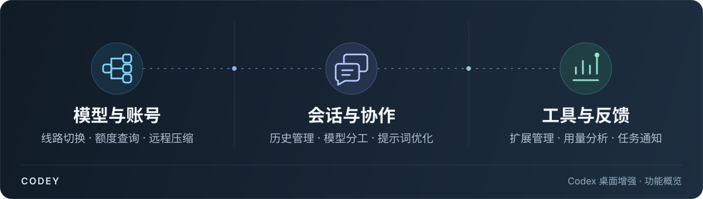

<h1 align="center">Codey</h1>

<strong>Codex 桌面客户端的增强启动器</strong> 集中管理模型线路、账号、会话和扩展，查看用量并接收任务通知。

  
  
  

  <a href="https://github.com/SuperGness/codey/releases/latest">下载稳定版</a> ·
  <a href="#主要功能">主要功能</a> ·
  <a href="#开始使用">开始使用</a> ·
  <a href="https://github.com/SuperGness/codey/issues">问题反馈</a>

## 主要功能

### 在控制台集中管理

| 功能 | 可以做什么 |
| :--- | :--- |
| **模型线路** | 管理官方与第三方线路，在对话中切换模型和思考强度。 |
| **官方账号** | 管理多个 ChatGPT 账号及额度，按需启用 Sign in with ChatGPT 官方直连授权。 |
| **用量分析** | 查询请求记录，分析模型用量、输出速度和错误。 |
| **会话管理** | 导入、导出会话，删除指定轮次并从备份恢复。 |
| **扩展管理** | 集中管理 MCP、Skill、可信 Codey 原生插件与 Codex 插件市场资源。 |
| **任务通知** | 通过飞书、企业微信、Telegram、ntfy 或微信 ClawBot 接收完成、失败和等待介入通知。 |
| **诊断与更新** | 检查和修复配置问题，按需关闭自动检查或选择稳定版、实验版更新。 |

### 在 Codex 中继续工作

- **远程压缩**：使用上游压缩或网关摘要，在满足历史完整性和容量条件时跨线路交接。
- **会话统计**：常驻查看轮数、Token 用量、缓存命中和最近一轮的平均输出速度。
- **模型分工**：按需将检索、开发和复核交给专用子代理，并调整各角色的模型与思考深度。
- **提示词优化**：一键优化输入内容，结果可继续编辑。
- **编程规则**：通过可选提示规则，减少不必要的兼容层、兜底代码和重复检查。
- **文件工具**：可选启用 FastCtx，读取、搜索文件并批量替换内容。
- **桌面操作**：通过可选的 Codey Computer Use 插件读取应用状态并执行点击、输入和滚动。

<strong>扩展集成与维护能力</strong>

- **插件线路**：通过可信插件扩展线路、密钥轮换和账号接入方式。
- **任务查询**：通过授权接口查询正在运行和失败的任务数量。
- **发布管理**：独立控制台支持正式版与实验版发布、定向推送和历史正式版回滚。

## 开始使用

**[下载稳定版](https://github.com/SuperGness/codey/releases/latest) → 打开 Codey → 在 Codex 中进入 Codey 控制台**

请先安装 Codex 桌面客户端；Codey 支持 macOS 和 Windows，打开后会自动启动 Codex。通过 Codex 内的 Codey 按钮进入控制台，设置保存后在后台应用，生效结果和重启要求以界面提示为准。

> [!IMPORTANT]
> 启动可能重启所选 Codex，请先结束正在运行的任务；仅支持可明确识别的客户端，多版本共存时需明确选择。

## 使用边界

> [!WARNING]
> 账号导出文件含登录凭据，第三方密钥及部分通知凭据以明文保存在本机配置和备份中，请妥善保管。安装包和原生插件仅使用可信来源；原生插件拥有与 Codey 相同的系统权限。

| 场景 | 需要了解 |
| :--- | :--- |
| **官方账号** | 官方线路需添加账号；默认账号决定客户端登录身份，各线路使用各自账号。 |
| **上下文与换线** | 本地路由的上下文预算不能扩大服务商容量；兼容性取决于服务商和 Codex 版本，历史无法完整恢复时需源账号交接，来源不明时需先回原线路。 |
| **客户端集成** | 页面增强依赖 Codex 版本；Codey 不修改客户端安全开关，集成失败时会在确认清理后尝试原生启动。 |
| **桌面操作** | 需在 Codey 中手动准备插件，再到 Codex 安装启用；支持 macOS 14 及以上和 Windows，macOS 需辅助功能与屏幕录制权限，升级后可能需重新授权。 |
| **编程规则** | 规则属于可选提示，已有会话在下次压缩后生效。 |
| **更新策略** | 关闭自动检查后仍可手动检查稳定版；实验版可能存在功能或数据兼容问题，启用前请备份重要数据。 |

## 许可与第三方声明

Codey 使用 [AGPL-3.0-only](LICENSE) 许可证，实现说明见 [开发文档](INTERNAL_DEVELOPMENT.md)。

<strong>FastCtx 第三方声明</strong>

    This product includes FastCtx
    (https://github.com/yc-duan/fastctx), Copyright (c) 2026 yc-duan,
    used under the Apache License 2.0.

    FastCtx is redistributed and/or modified here by the maintainer of
    this distribution. Any such change is that maintainer's own work
    and their sole responsibility. It is not endorsed by, not
    supported by, and not attributable to the author of FastCtx, who
    accepts no liability of any kind arising from this distribution or
    from anything built on top of it.

## 联系与致谢

由 [SuperGness](https://github.com/SuperGness) 创建和维护。问题与建议请提交 [Issue](https://github.com/SuperGness/codey/issues)；集成、再分发或合作请联系 [kimzane9991@gmail.com](mailto:kimzane9991@gmail.com)。

感谢 [linuxdo](https://linux.do/) 社区的讨论、分享与反馈。
